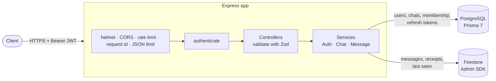
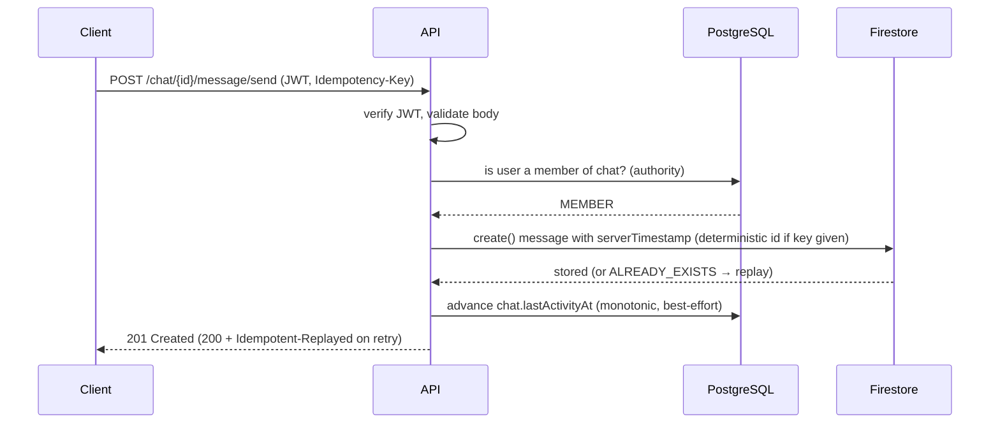
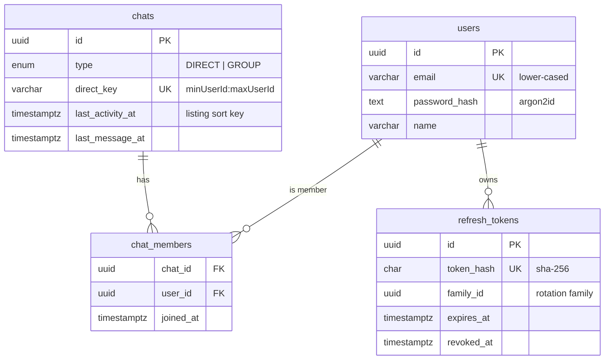

# nodejs-chat-backend

Production-grade one-to-one chat backend built with **Node.js 24, TypeScript (strict), Express 5, PostgreSQL (Prisma 7), Firebase Firestore (Admin SDK) and Docker**.

PostgreSQL owns identities, chats and membership. Firestore owns messages, read receipts and last-seen pointers. Every request is authenticated with a JWT, and every chat operation is authorised against PostgreSQL membership before Firestore is touched.

---

## Contents

1. [Features](#features)
2. [Architecture](#architecture)
3. [Technology stack](#technology-stack)
4. [Data model](#data-model)
5. [API](#api)
6. [Authentication and security](#authentication-and-security)
7. [Getting started](#getting-started)
8. [Configuration](#configuration)
9. [Firebase setup](#firebase-setup)
10. [Database migrations and seeding](#database-migrations-and-seeding)
11. [Docker](#docker)
12. [Testing](#testing)
13. [Code quality](#code-quality)
14. [CI/CD](#cicd)
15. [Deployment](#deployment)
16. [Troubleshooting](#troubleshooting)
17. [Known limitations](#known-limitations)
18. [Future improvements](#future-improvements)

Design trade-offs and their costs: [docs/tradeoffs.md](docs/tradeoffs.md).

---

## Features

| Capability       | Behaviour                                                                                                                                    |
| ---------------- | -------------------------------------------------------------------------------------------------------------------------------------------- |
| One-to-one chats | `POST /chat/create` returns the existing chat or creates one. A `UNIQUE` canonical participant-pair key makes concurrent creation race-free. |
| Messaging        | Messages stored in Firestore with **server timestamps**; length/empty validation; optional `Idempotency-Key` makes retries safe.             |
| Message history  | Cursor pagination (default 50, max 100), stable ordering by `(createdAt, documentId)`, chronological within a page.                          |
| Read receipts    | One document per reader per message; atomic `create()` makes duplicates idempotent and keeps the first `readAt`.                             |
| Last seen        | Per-user pointer that **never moves backwards**, updated inside a Firestore transaction.                                                     |
| Chat list        | Most recently active first, with members and last-message metadata, keyset pagination.                                                       |
| Auth             | Registration, login, Argon2id passwords, 15-minute JWT access tokens, rotating refresh tokens with reuse detection.                          |
| Operations       | Structured Pino logs with request IDs, liveness/readiness probes, graceful shutdown, OpenAPI 3.1 + Swagger UI.                               |

## Architecture

A **modular monolith**: one deployable, with modules (`auth`, `users`, `chats`, `messages`, `health`) that each own their routes, controller, service, schema and repository. Business logic depends on small interfaces (`ChatRepository`, `MessageStore`, `ReceiptStore`, …); the composition root (`src/container.ts`) is the only place concrete PostgreSQL/Firestore implementations are chosen.





**Cross-database consistency.** There is no distributed transaction, and none is faked. PostgreSQL decides _who may act_; Firestore records _what happened_. The message write is the commit point; the PostgreSQL activity timestamp used for chat ordering is derived metadata, updated afterwards with a forward-only `UPDATE … WHERE last_message_at < $1`. If that update fails, the message is still delivered and the failure is logged (`event=chat_activity_sync_failed`); a client retry with the same `Idempotency-Key` re-runs the sync. See trade-off #3 in [docs/tradeoffs.md](docs/tradeoffs.md).

## Technology stack

| Concern            | Choice                                                                                            |
| ------------------ | ------------------------------------------------------------------------------------------------- |
| Runtime / language | Node.js 24 LTS, TypeScript 6 (`strict`, `exactOptionalPropertyTypes`, `noUncheckedIndexedAccess`) |
| HTTP               | Express 5, helmet, cors, express-rate-limit                                                       |
| Relational DB      | PostgreSQL 17, Prisma 7 with the `pg` driver adapter                                              |
| Document DB        | Firebase Firestore via `firebase-admin` 14                                                        |
| Validation         | Zod 4 (also generates the OpenAPI JSON Schemas)                                                   |
| Auth               | `jsonwebtoken` (HS256, pinned), `argon2` (Argon2id)                                               |
| Logging            | Pino + pino-http                                                                                  |
| Tests              | Vitest 5, Supertest, real PostgreSQL + Firestore emulator                                         |
| Tooling            | ESLint (typescript-eslint strict-type-checked), Prettier, Husky, lint-staged, Commitlint          |
| Delivery           | Docker multi-stage image, Docker Compose, GitHub Actions                                          |

## Data model

### PostgreSQL



Key constraints: `UNIQUE(direct_key)` (one DIRECT chat per pair, even under concurrency), `UNIQUE(chat_id, user_id)`, `CHECK ((type = 'DIRECT') = (direct_key IS NOT NULL))`, cascading foreign keys. Indexes: `chats(last_activity_at DESC, id DESC)` for listing, `chat_members(user_id, chat_id)` for membership.

### Firestore

```
chats/{chatId}/messages/{messageId}                      id, chatId, senderId, text, createdAt*, updatedAt*, editedAt, deletedAt, idempotencyKeyHash
chats/{chatId}/messages/{messageId}/readReceipts/{userId} chatId, messageId, userId, readAt*
chats/{chatId}/lastSeen/{userId}                          chatId, userId, messageId, messageCreatedAt, lastSeenAt*
                                                          (* = server timestamp)
```

No unbounded arrays; each receipt is its own small document. `text` is exempt from indexing. Clients have **no** direct Firestore access (`firestore.rules` deny all).

## API

All routes are served under **`/api/v1`** and, to honour the assignment's literal contract, also at the unversioned path (e.g. `POST /chat/create`). Interactive docs: `GET /docs` (when `ENABLE_API_DOCS=true`); raw spec: `GET /docs/openapi.json`.

| Method | Path                                       | Auth | Purpose                                                          |
| ------ | ------------------------------------------ | ---- | ---------------------------------------------------------------- |
| POST   | `/auth/register`                           | –    | Create account, returns user + tokens                            |
| POST   | `/auth/login`                              | –    | Exchange credentials for tokens                                  |
| POST   | `/auth/refresh`                            | –    | Rotate refresh token                                             |
| POST   | `/auth/logout`                             | –    | Revoke refresh-token family                                      |
| GET    | `/users/me`                                | ✔    | Current profile                                                  |
| POST   | `/chat/create`                             | ✔    | **API 1** – create or get chat (`userAId`, `userBId` → `chatId`) |
| POST   | `/chat/:chatId/message/send`               | ✔    | **API 2** – send message (`senderId`?, `text`)                   |
| GET    | `/chat/:chatId/messages?limit=50&cursor=`  | ✔    | **API 3** – get messages                                         |
| POST   | `/chat/:chatId/message/:messageId/read`    | ✔    | **API 4** – mark read (`userId`?)                                |
| POST   | `/chat/:chatId/lastseen`                   | ✔    | **API 5** – update last seen (`userId`?, `messageId`)            |
| GET    | `/user/:userId/chats?limit=&cursor=`       | ✔    | **API 6** – list chats (alias `/users/:userId/chats`)            |
| GET    | `/health`, `/health/live`, `/health/ready` | –    | Probes                                                           |

Response envelope: `{ "success": true, "data": …, "meta": … }` or `{ "success": false, "error": { "code", "message", "details": [] } }`.

**Deviation from the original contract (deliberate):** identity comes from the access token. `senderId` / `userId` in bodies and `:userId` in the chat-list path are accepted for compatibility but **must equal the authenticated user**, otherwise `403`. `chat/create` requires the caller to be one of the two participants.

```bash
TOKEN=$(curl -s localhost:3000/api/v1/auth/login -H 'content-type: application/json' \
  -d '{"email":"alice@example.com","password":"local-dev-password-123"}' | jq -r .data.tokens.accessToken)
curl -s localhost:3000/api/v1/chat/create -H "authorization: Bearer $TOKEN" \
  -H 'content-type: application/json' -d '{"userAId":"<alice-id>","userBId":"<bob-id>"}'
```

## Authentication and security

- **Passwords**: Argon2id (19 MiB, t=2, p=1 – OWASP minimum), 12–128 chars. Unknown-email logins still run a hash verification to equalise timing.
- **Access tokens**: HS256 JWT, 15 min, `iss`/`aud` checked, algorithm pinned (blocks `alg: none` / confusion), secret ≥ 32 chars validated at boot.
- **Refresh tokens**: 256-bit opaque, stored as SHA-256 only, single-use rotation; reuse of a consumed token revokes the whole family.
- **Authorisation**: membership checked in PostgreSQL before every Firestore read/write; IDOR and impersonation attempts return `403`.
- **Hardening**: helmet headers, CORS allow-list, 32 KB body limit, strict Zod schemas (unknown fields rejected → no mass assignment / prototype pollution), global, per-IP auth and per-account login rate limits, request timeouts, generic error bodies (no stack/SQL/Firebase details), Pino redaction of credentials.

## Getting started

Prerequisites: **Node.js ≥ 24.11, pnpm 12, Docker** (the Firestore emulator runs in a container, so no local Java is needed).

```bash
git clone https://github.com/MNikks01/nodejs-chat-backend.git
cd nodejs-chat-backend
./scripts/setup.sh          # install, .env, start Postgres + Firestore emulator, migrate, seed
pnpm dev                    # http://localhost:3000  · docs at /docs
```

`setup.sh` is equivalent to:

```bash
pnpm install
cp .env.example .env && sed -i.bak "s|^JWT_ACCESS_SECRET=.*|JWT_ACCESS_SECRET=$(openssl rand -base64 48)|" .env
pnpm infra:up               # postgres:5432 (dbs: chat, chat_test) + firestore emulator:8080
pnpm db:migrate:deploy
pnpm db:seed                # alice/bob/carol@example.com, password local-dev-password-123
```

## Configuration

All configuration is environment-based and **validated at startup** (`src/config/env.ts`); the process exits with a list of invalid variable _names_ (never values). See [`.env.example`](.env.example).

| Variable                                            | Required | Default                   | Notes                                             |
| --------------------------------------------------- | -------- | ------------------------- | ------------------------------------------------- |
| `DATABASE_URL`                                      | ✔        | –                         | `postgresql://…`                                  |
| `FIREBASE_PROJECT_ID`                               | ✔        | –                         | `demo-*` IDs work offline with the emulator       |
| `JWT_ACCESS_SECRET`                                 | ✔        | –                         | ≥ 32 chars; `openssl rand -base64 48`             |
| `FIRESTORE_EMULATOR_HOST`                           |          | –                         | e.g. `localhost:8080`; omit in production         |
| `FIREBASE_SERVICE_ACCOUNT_BASE64`                   |          | –                         | Only if not using Application Default Credentials |
| `PORT` / `LOG_LEVEL` / `NODE_ENV`                   |          | 3000 / info / development |                                                   |
| `JWT_ACCESS_TTL_SECONDS` / `REFRESH_TOKEN_TTL_DAYS` |          | 900 / 30                  |                                                   |
| `CORS_ORIGINS`                                      |          | empty (no CORS)           | comma-separated allow-list                        |
| `TRUST_PROXY`                                       |          | false                     | set `true` behind exactly one proxy/LB            |
| `ENABLE_API_DOCS`                                   |          | false                     | serves `/docs`                                    |
| `RATE_LIMIT_*`, `AUTH_RATE_LIMIT_*`                 |          | 300/min, 10/15 min        | per instance                                      |

## Firebase setup

**Local / CI:** nothing to configure. The emulator image (`infra/docker/firestore-emulator.Dockerfile`) runs project `demo-chat-backend`; `demo-` projects never contact Google.

**Real project:**

1. Create a Firebase project and a Firestore database (Native mode).
2. Deploy rules/indexes: `firebase deploy --only firestore:rules,firestore:indexes --project <id>` (uses `firebase.json`).
3. Credentials, in order of preference:
   - **On GCP (Cloud Run/GKE):** attach a runtime service account with `roles/datastore.user`; leave both Firebase credential variables unset (ADC).
   - **Elsewhere:** create a key for a dedicated service account with only `roles/datastore.user`, store it in your secret manager, inject it as `FIREBASE_SERVICE_ACCOUNT_BASE64` (`base64 -w0 key.json`). Never commit the JSON (it is git-ignored).

## Database migrations and seeding

| Command                  | Use                                                              |
| ------------------------ | ---------------------------------------------------------------- |
| `pnpm db:migrate`        | Create/apply a migration in development (`prisma migrate dev`)   |
| `pnpm db:migrate:deploy` | Apply committed migrations (CI, production) – never resets data  |
| `pnpm db:generate`       | Regenerate the Prisma client into `src/generated/prisma`         |
| `pnpm db:seed`           | Idempotent demo data (refuses to run when `NODE_ENV=production`) |
| `pnpm db:studio`         | Browse data                                                      |

## Docker

```bash
docker compose -f infra/docker-compose.yml up -d --build   # postgres, firestore emulator, migrate job, app
curl localhost:3000/health/ready
docker compose -f infra/docker-compose.yml down             # add -v to drop the database volume
```

The image (`infra/docker/Dockerfile`) is multi-stage: deterministic `--frozen-lockfile` install → TypeScript build → runtime stage with production dependencies only, non-root `node` user, `tini` as PID 1 for signal forwarding, and a `HEALTHCHECK`. A separate `migrate` target runs `prisma migrate deploy` as a one-shot job, so the runtime image carries no migration tooling. Ports are bound to `127.0.0.1` in the dev compose file.

## Testing

```bash
pnpm infra:up                # PostgreSQL + Firestore emulator
pnpm test:unit               # 75 fast tests, no infrastructure
pnpm test:integration        # 17 tests against real PostgreSQL + emulator
pnpm test:e2e                # 58 HTTP tests (e2e + security suites)
pnpm test:coverage           # everything + coverage (thresholds enforced)
```

Infrastructure suites use the isolated `chat_test` database (migrated automatically) and random identifiers, so they never touch development data. Current totals: **150 tests, 96.2 % statements / 90.0 % branches / 98.3 % functions / 97.5 % lines**.

## Code quality

`pnpm check` runs format check → ESLint → `tsc --noEmit` → unit tests → production build. Husky runs lint-staged + typecheck on commit and Commitlint (Conventional Commits) on the message.

## CI/CD

| Workflow       | Trigger                   | Jobs                                                                                                                                                   |
| -------------- | ------------------------- | ------------------------------------------------------------------------------------------------------------------------------------------------------ |
| `ci.yml`       | push/PR to `main`, manual | format, lint, types, unit, build · integration + E2E + coverage inside `firebase emulators:exec` with a Postgres service · `pnpm audit` · Docker build |
| `security.yml` | push/PR, weekly           | gitleaks (full history), CodeQL, `pnpm audit`, dependency review, Trivy image scan                                                                     |
| `deploy.yml`   | manual only               | Cloud Run deploy via Workload Identity Federation, opt-in migration job, health-gated traffic shift                                                    |

No production credentials are used in CI: tests run against the emulator and a throw-away Postgres service.

## Deployment

The reference target is **Google Cloud Run + Cloud SQL for PostgreSQL + Firestore** (same cloud, so Firestore uses ADC – no key files). The deploy workflow is inert until repository variables are configured; it builds, optionally runs migrations as a Cloud Run Job, deploys a tagged revision **without traffic**, checks `/health/ready`, then shifts traffic. Rollback = route traffic back to the previous revision.

## Troubleshooting

| Symptom                                             | Fix                                                                                           |
| --------------------------------------------------- | --------------------------------------------------------------------------------------------- |
| `Invalid environment configuration` at boot         | Read the listed variable names; compare with `.env.example`.                                  |
| `/health/ready` shows `firestore: down`             | Is the emulator up (`docker compose ps`)? Is `FIRESTORE_EMULATOR_HOST` set for local runs?    |
| `503 DATABASE_UNAVAILABLE`                          | PostgreSQL unreachable; check `DATABASE_URL` and `pnpm infra:up`.                             |
| `Cannot find module '…/generated/prisma/client.js'` | Run `pnpm db:generate`.                                                                       |
| `MetadataLookupWarning` in test output              | Harmless: google-auth probes GCP metadata when no credentials are configured (emulator mode). |

## Known limitations

- Rate limits use an in-memory store (per instance); use a shared store (e.g. Redis) when running multiple replicas.
- Chat-list ordering is keyset-paginated on a mutable key (`last_activity_at`): a chat that becomes active while a client is paging can move to page 1 and be skipped by that client's later pages. This is inherent to "most recent first" and acceptable for chat lists.
- If the PostgreSQL activity update fails after a successful Firestore write, the chat list ordering lags until the next message or an idempotent retry (documented trade-off; no data loss).
- Refresh tokens are returned in the response body (API-client friendly). Browser clients should wrap them in an `HttpOnly; Secure; SameSite=Strict` cookie at a BFF.
- Optional features (group chats, message edit/delete) are not implemented; the schema (`ChatType.GROUP`, `editedAt`, `deletedAt`) is ready for them.

## Future improvements

Real-time delivery over WebSockets/SSE (or Firestore listeners with custom tokens and member-scoped rules), push notifications via FCM, group chats with roles, message edit/delete with tombstones, attachments via signed Cloud Storage URLs, search via a dedicated index, retention policies with Firestore TTL, OpenTelemetry tracing and Prometheus metrics, Redis-backed rate limiting, and a transactional outbox if more PostgreSQL side-effects are added.

## License

[MIT](LICENSE)
